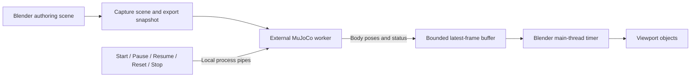

# MuJoCo-driven live physics in Blender

**Status:** Implemented and validated in two stages: initial live-viewport integration (`4af4835`), followed by physics-driven joint targets in a separate commit. Physics integration is grouped in [`robot_arm_library/physics/`](../../../robot_arm_library/physics/) as `runtime.py`, `protocol.py`, `worker.py`, `client.py`, `blender.py`, and `control.py`.

Validation: shared initialization/reset and standalone-renderer tests; real external worker/protocol/lifecycle tests; headless Blender falling/contact, articulated/floating/duplicate robots, nested mixed mounts, scaled parents, restoration/failure/save/scene-switch checks; existing export/Sticky Move/Magnetic Move/sensor/graph regressions; and graphical Blender scene-panel/timer playback smoke test. Blender-side MuJoCo was deliberately blocked during saved-scene playback tests. The separate joint-control stage adds implicit PD servos, native/configured effort limits, contact-blocked targets, paused edits/reset/restore, duplicate-instance mapping, and graphical target/actual readout checks.

## Goal and confirmed behavior

Use MuJoCo as the authoritative physics engine for the exported world, and show its simulated motion in Blender's viewport. This bypasses Blender physics for participating objects; it does not replace Blender's internal physics engine.

Confirmed for the first release:

- Preserve the current runtime approach: simulation runs in the external Python selected for the scene. Expose the same existing Python setting in **Scene Properties > MuJoCo World** and **Sim > MuJoCo**. Keep the exporter's existing local-backend path and external fallback; do not require MuJoCo inside Blender for live playback of an already-supported scene.
- Configure MuJoCo at the **scene level**, not independently on each object. One composed MuJoCo world resolves the included objects and their interactions. Preserve current object defaults: ordinary meshes are fixed colliders; Active rigid bodies move; imported robot physics comes from MJCF.
- Add live viewport **Start, Pause, Resume, Reset, Stop** controls. Do not bake animation or drive Blender's timeline.
- **Stop restores the original authoring pose**, including after startup failure or a worker crash.
- Keep the existing **Play** external-viewer workflow and **Export** behavior. Add a clearly separate **Live in Blender** section rather than silently changing Play.
- Simulate the same supported robots, meshes, contacts, and rigid mounts as the existing world exporter. Import/authoring limitations remain unchanged. The initial integration preserves the viewer's actuator initialization and disables live joint editing. The separately delivered follow-up enables explicit, limited-effort hinge/slide targets during playback without teleporting simulated positions; it is not a hardware/ROS controller.

## Blender UI: scene-wide engine, per-object properties

The main configuration belongs in the Properties editor's **Scene Properties > MuJoCo World** panel. Blender's **Physics Properties** is object-specific; it remains the place to set a selected mesh's rigid-body properties. **World Properties** controls the visual environment and is not the proposed home for the physics engine.

Illustrative layout, not an existing panel:

```text
Properties editor > Scene Properties
  MuJoCo World
    Runtime: MuJoCo (external Python)
    Python: [existing executable setting]
    Gravity: [0, 0, -9.81] m/s²
    Physics timestep: [0.002] seconds
    Viewport updates: [30] per second
    Scope: supported scene objects included by the exporter
    [Start] [Pause / Resume] [Reset] [Stop]
    Status: Stopped / Starting / Running / Paused / Error
```

The **Sim > MuJoCo** sidebar remains a convenient shortcut to these same scene properties, session status, and playback operators, alongside the existing **Export / Play** buttons. Do not maintain two independent copies of world settings or two simulations.

| Level | Settings and behavior |
|---|---|
| Scene | One MuJoCo runtime, gravity, physics timestep, viewport update rate, and session lifecycle. Settings are stored on the Blender Scene datablock. |
| Ordinary mesh | Existing Physics Properties: Active/Passive rigid body, mass, friction, bounce, and collision shape. No rigid body means a fixed collider, not an automatically falling object. Existing disabled-body and visibility/export rules remain unchanged. |
| Imported robot | Source MJCF supplies masses, joints, collision geometry, and actuators; individual visual meshes do not acquire independent physics bodies. |
| Rigid mount | Existing mount metadata makes source and target one physical assembly while preserving internal articulated joints. |

Starting the scene-wide simulation includes all **supported/exportable physical objects**, not just the selected object. Cameras, lights, magnetic markers, and unsupported object types are not automatically turned into colliders. All included bodies interact through the same MuJoCo world. Global gravity/timestep do not replace per-body masses or contact properties, and enabling live playback does not add Active rigid bodies to every mesh.

Scene gravity and timestep must be applied consistently by **Live in Blender**, **Export**, and external **Play**. Preserve the current export defaults of gravity `(0, 0, -9.81)` and timestep `0.002` seconds when no new settings are supplied. Changing scene options requires Stop and a fresh export/Start; it must not mutate an active model silently. MuJoCo owns playback dynamics; Blender rigid-body settings are authoring inputs, not a second solver running on the same objects.

This adds scene-level add-on panels, not a new native Blender engine selector or a global replacement for every Blender physics feature. Scene settings persist in the saved file; the running worker and temporary simulation poses do not.

## Verified starting points

- [The generated renderer](../../../render_world.py) initializes the composed model, applies home keyframes and joint overrides, places floating bases, and advances MuJoCo's viewer. It does not return poses to Blender. Its source of truth is `_render_script()` in [world_exporter.py](../../../robot_arm_library/world_exporter.py); do not implement the feature by hand-editing the generated script.
- [world_exporter.py](../../../robot_arm_library/world_exporter.py) already records robot instance IDs, prefixes, scene body names, mount relationships, and initial poses. The manifest currently has version 1.
- [compiled_importer.py](../../../robot_arm_library/compiled_importer.py) stores original MuJoCo body/joint names on Blender objects. Its `mujoco_body_id` values belong to the original model, not necessarily the composed world. Hinge/slide motion objects have qpos drivers.
- [blender_addon.py](../../../robot_arm_library/blender_addon.py) collects exportable robots and meshes, selects the external Python, launches Play, and registers Blender timers.
- [mounting.py](../../../robot_arm_library/mounting.py) handles nested physical ownership and persistent rigid mounts. Those boundaries must also be respected during playback.
- MuBlE's useful reference is copying simulated body poses into Blender objects. Its robot-specific, render-time mapping is not itself a generic live playback implementation.

## Architecture



Use one supervised child process per active session, local stdin/stdout pipes, and a versioned JSON protocol. No network service, robosuite dependency, or MuBlE dependency is needed. Reader threads may decode messages, but **only Blender's main thread may access or change `bpy` data**.

Physics runs at the model's fixed timestep. Publish viewport snapshots at a bounded rate, initially targeting 30 updates/second, independently of physics stepping. Drop superseded pose frames rather than accumulating lag; command acknowledgements and errors must not be dropped. Report actual simulation time and lag rather than promising real-time performance for every model.

## Implementation phases

### 1. Share and verify simulation initialization

**Files:** [physics/runtime.py](../../../robot_arm_library/physics/runtime.py); update [world_exporter.py](../../../robot_arm_library/world_exporter.py) and [world_export_worker.py](../../../robot_arm_library/world_export_worker.py).

- Introduce optional scene-level world options for gravity and timestep, with the current defaults when omitted. Pass them through composition, manifest/export requests, and the external export worker. Preserve existing positional export calls and version-1 manifest compatibility; viewport update rate remains a client/stream option, not the MuJoCo timestep.
- Extract model initialization from the renderer template into a Blender-independent runtime helper: home state, per-instance qpos, floating-base placement, and `mj_forward`.
- Define the reset state after initialization, including simulation time, positions, velocities, actuator state, controls, and other integration state needed for reproducible reset.
- Make the live worker and generated viewer use the same initialization semantics. Preserve standalone exports: if the generated viewer imports a helper, export a companion copy with it and test execution outside the checkout.
- Preserve current sensor-only output, asset paths, mounted free-joint removal, and articulated joints. Do not add continuous sensor capture to this phase.

**Gate:** viewer initialization and live initialization produce matching state for fixed, floating, and mounted robots. Existing standalone viewer exports still run without the add-on installed.

### 2. Define session bindings and message contracts

**Files:** [physics/protocol.py](../../../robot_arm_library/physics/protocol.py); export/binding integration in [blender_addon.py](../../../robot_arm_library/blender_addon.py), with additive manifest changes only if needed.

- Build a frozen session map from the exact objects collected for export, not from a second enumeration with potentially different visibility or ordering.
- Resolve robot bodies by instance prefix plus original MuJoCo body name; resolve scene bodies by their exported asset/body name. Never reuse source-model numeric IDs against the composed model.
- Keep references to participating Blender objects and their original parent relationships. Resolve nested robot/mesh ownership with the same rules as mounting/export.
- Worker handshake returns protocol version, session ID, resolved body IDs/names, and initialized state. Commands use IDs; state messages carry sequence number, simulation time, body positions, and scalar-first quaternions.
- Validate missing/ambiguous mappings before applying any poses. Explicitly reject unsupported XML-fallback/placeholder previews or unmapped unnamed bodies instead of showing partial robot motion.
- Validate message sizes, shapes, finite values, protocol/session IDs, and stale frame sequences. Keep existing version-1 manifests readable; version any breaking schema change.

**Gate:** duplicate robot instances and Blender `.001` names map correctly, including models whose body IDs change after composition.

### 3. Implement the persistent external runtime and client

**Files:** [physics/worker.py](../../../robot_arm_library/physics/worker.py) and [physics/client.py](../../../robot_arm_library/physics/client.py).

- Start the worker using the existing selected interpreter and the add-on package path, following the export worker's environment handling. Keep native MuJoCo imports out of Blender-only modules.
- Export live-session artifacts into a session-owned temporary directory, not over the user's saved world files. Reuse export collection/composition without requiring an unrelated USD export for viewport playback.
- Collect Blender data on the main thread; perform pure export/worker work asynchronously where possible. Do not block the UI waiting for worker startup, stdout, or process exit.
- Support `start`, `pause`, `resume`, `reset`, and `stop`, with acknowledgements and bounded startup/command timeouts. Keep stdout for protocol messages and drain diagnostics separately from stderr.
- Use a monotonic scheduler with fixed MuJoCo steps and bounded catch-up. Keep control input responsive while paused or under load; discard stale queued frames on pause/reset.
- Store the latest pose frame in bounded storage. Stop gracefully first, then terminate/kill only the owned child if its deadline expires. Join readers and remove session artifacts after exit.
- Do not open a MuJoCo graphics window for live playback. Existing external Play remains a separate path; prevent concurrent launches against an active live session.

**Gate:** worker/client lifecycle tests run without Blender or a display, including absent MuJoCo, bad models, paths with spaces, malformed messages, timeouts, crashes, and repeated start/stop.

### 4. Apply poses without damaging the authoring scene

**Files:** [physics/blender.py](../../../robot_arm_library/physics/blender.py); narrowly scoped integration with [compiled_importer.py](../../../robot_arm_library/compiled_importer.py) and [mounting.py](../../../robot_arm_library/mounting.py) if required.

- Capture the original authoring state before any mutation: transforms, parent inverses, affected qpos properties, relevant driver/constraint mute states, rigid-body participation, and current frame.
- After successful export/binding validation, suspend competing Blender physics, animation, and pose drivers only where necessary for participating objects. Preserve the original states for restoration.
- Apply authoritative world-space body poses in parent-before-child order, converting through actual Blender parent frames. Preserve visual mesh offsets and scale; do not apply body transforms independently to both a body container and its child geometry.
- Handle fixed and floating robot bases, articulated links, dynamic meshes, robot-to-mesh and mesh-to-robot mounts, nested robots, sensors, and magnetic markers without double transforms.
- Test nonuniformly scaled parents and mounted hierarchies explicitly. Reject transforms the exporter cannot represent faithfully, such as unsupported shear, rather than introducing silent pose drift.
- Use the timer only to consume the newest complete frame, update mapped objects, and redraw. Do not advance simulation from the viewport frame rate.
- Keep the Blender frame fixed. Scene/model/physics edits require Stop and a fresh Start; disable conflicting add-on authoring/export controls while active and safely stop on incompatible external edits.
- Restore state through one idempotent cleanup path on Stop, error, scene switch, file load, pre-save, undo/redo, or add-on unregister. Never save temporary playback poses into the user's scene. If an object has been intentionally deleted, restore surviving participants without recreating geometry or undoing the user's deletion.

**Gate:** every mapped visual body agrees with MuJoCo after dependency-graph evaluation, and Stop restores the original transforms and driver states without changing mount metadata or source files.

### 5. Add scene-level panels, viewport shortcuts, and lifecycle states

**Files:** [blender_addon.py](../../../robot_arm_library/blender_addon.py), using the new session controller.

- Add the canonical **Scene Properties > MuJoCo World** panel with the shared Python field, gravity, timestep, viewport update rate, session status, and controls. Preserve current defaults and store settings per scene, not per object or per sidebar panel.
- Add **Live in Blender** shortcuts below the sidebar's existing Export/Play row, bound to the same scene settings and operators. Keep mass/friction/collision editing in existing object Physics Properties; clearly explain Active versus fixed behavior and MJCF robot ownership.
- Show state, simulation time, update rate/lag, and actionable errors even when no object is selected. Selection must not determine the simulation's scope.
- Implement `IDLE -> STARTING -> RUNNING <-> PAUSED -> STOPPING -> IDLE`, plus failure status after safe cleanup. Only one live session may own Blender objects at a time.
- **Start:** capture the authoring scene, export a fresh snapshot, validate bindings, then begin playback.
- **Pause/Resume:** pause physics as well as display updates; resume from the acknowledged paused state.
- **Reset:** restore the initialized MuJoCo state, publish it to Blender, and remain paused.
- **Stop:** end the worker, restore the pre-Start authoring state, and remove all session timers/readers/artifacts. Make repeated Stop harmless.
- Ensure registration/reload does not leave duplicate timers or handlers. Make errors distinguish export, interpreter/backend, protocol, mapping, and runtime failures.

**Gate:** the complete workflow is usable from the sidebar, including recovery from a failed Start and a subsequent successful Start.

### 6. Validate, document, and package

**Focused tests:** [test_simulation_runtime.py](../../../tests/test_simulation_runtime.py), [test_simulation_worker.py](../../../tests/test_simulation_worker.py) (including protocol/client checks), [test_simulation_control.py](../../../tests/test_simulation_control.py), [blender_live_physics_test.py](../../../tests/blender_live_physics_test.py), [blender_live_joint_control_test.py](../../../tests/blender_live_joint_control_test.py), and [blender_live_physics_gui_test.py](../../../tests/blender_live_physics_gui_test.py).

Acceptance scenarios:

1. A dynamic cube falls onto a passive table in Blender, matching the external MuJoCo state; the table remains fixed.
2. An articulated test robot moves under a controlled test stimulus and its links agree with MuJoCo. This is not a new user-facing robot controller.
3. A robot rigidly mounted to a moving platform follows it; its internal articulation remains independent. Cover surface and magnetic mounts, generic parts, robot-link targets, and assembly chains.
4. Multiple copies of the same robot, floating bases, rotated mounts, and supported scaled mesh parents retain correct transforms.
5. Pause freezes simulation time and poses; Resume continues; Reset reproduces the initial state; Stop exactly restores the authoring state within numerical tolerance.
6. Saved compiled robot scenes and mesh-only scenes run with MuJoCo imports deliberately blocked in Blender but available in the selected external Python.
7. Worker failure, deleted objects, undo, file load/save, scene switch, and add-on reload safely end the session, restore surviving participants, and leave no owned worker, timer, thread, or temporary directory behind.
8. Existing external Play, standalone exports, sensor-only mode, joint posing, Sticky Move, and Magnetic Move still work.
9. Scene Properties and sidebar settings stay synchronized, remain accessible with no object selected, persist across save/reopen, and remain independent between scenes. Only one scene may own an active session at a time.
10. Custom gravity/timestep reach local export, external export fallback, external Play, and live playback consistently; omitted settings preserve existing defaults. An unconfigured mesh remains fixed, while an Active cube falls, regardless of which object is selected.

Run the smallest new unit suites first, then the existing exporter/runtime/physics/mount suites and the focused Blender regression scripts. Use temporary test scenes, never the user's saved scene/export artifacts. Finish with a manual graphical viewport smoke test: headless checks cannot prove that the actual UI stays responsive.

Update [README.md](../../../README.md) with implemented controls, restoration behavior, supported previews, and limitations only after implementation. Rebuild the add-on using [Makefile](../../../Makefile)'s existing `make zip` target and verify the new runtime modules are included.

## Dependencies and delivery order

1. Shared initialization and protocol/bindings establish the contracts.
2. Worker/client depends on those contracts; Blender pose application depends on validated bindings and received frames.
3. UI/lifecycle integration depends on both the worker/client and reversible pose application.
4. Packaging follows targeted regressions and the manual viewport acceptance check.

Deliver first a falling-cube vertical slice, then articulated robots, then mixed mounted assemblies and lifecycle hardening. These are implementation milestones, not permission to ship a cube-only feature as the completed request.

## Explicitly deferred

- Timeline baking, animation export, and keeping the final simulated pose.
- Live geometry/physics editing, animated kinematic inputs, interactive dragging forces, and general actuator authoring. The separately implemented hinge/slide target UI is limited to temporary physics-preview servos, not arbitrary coupled transmissions.
- ROS2/ros2_control, data-graph actuation, continuous sensor streaming, and edge deployment.
- URDF conversion, new articulated-robot construction, automatic concave decomposition, and replacing Blender's internal solver globally.

**Completion rule:** live playback, restoration, existing viewer/export behavior, and mounted assemblies must all be verified before the feature is considered complete.
